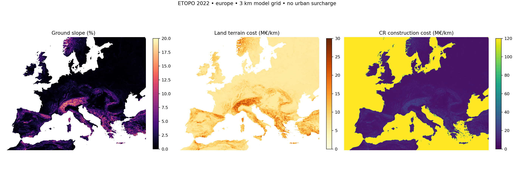

# ETOPO terrain integration

All bundled profiles now use `data/ETOPO_2022_v1_60s_N90W180_bed.tif`
through `terrain_kind: "etopo"`. Japan, Taiwan and the slope-fast override no
longer select their former local relief/DEM files. No old elevation or RGB
relief layer participates in an ETOPO run. City, population, country boundaries
and optional land-class/exclusion inputs continue to serve their separate roles.
Existing saved run configurations retain their recorded terrain settings.

## Source and compatibility checks

[NOAA ETOPO 2022](https://www.ncei.noaa.gov/products/etopo-global-relief-model)
combines topography and bathymetry. This is the **bedrock** version: under ice
sheets it represents the bed rather than the ice surface.

The supplied file was inspected and fully scanned before switching configuration:

- 21,600 × 10,800 pixels, covering longitude −180…180 and latitude −90…90.
- 60 arc seconds (1/60 degree), single-band float32, metre elevation units.
- EPSG:9518: WGS84 horizontal coordinates with EGM2008 orthometric heights.
- 233,280,000 valid pixels; zero missing pixels; nodata sentinel −99,999.
- Elevation range −10,752.08 to 8,157.36 m.

The existing RGB relief reader is incompatible with this single-band elevation
file. The new `etopo` mode uses the elevation reader and continuous slope cost
curve. It validates metre units and does not impose the legacy DEM mode's hard
railway-grade cutoff on ground slope. In the initial DEM-mode trial that cutoff
would have blocked 139,985 European land cells; ETOPO mode blocks none.

## Slope and construction cost

The algorithm averages source elevations onto its padded 3 km regional grid,
then computes `sqrt((dz/dx)^2 + (dz/dy)^2)` with metric spacing. Exported slope is
rise/run (0.02 = 2%), not degrees. This measures slope after spatial averaging;
it does not preserve every sub-grid obstacle.

The existing multiplier anchors remain: 0%, 1%, 2%, 5%, 10%, 20% ground slope
map to 1, 1.2, 1.5, 2, 3, 5 times baseline construction cost, with linear
interpolation and a cap of 5. CR land terrain costs therefore range from
€6M to €30M/km; HSR ranges from €20M to €100M/km before urban surcharges.

The country-boundary mask identifies sea and optional land classes identify
inland water. Water slope is zeroed and charged the existing crossing premium
(€120M/km for sea by default). Negative elevation alone is deliberately not a
water classifier: below-sea-level land must remain land. ETOPO is not a lake or
land-cover classification product, so lake detection requires suitable land
classes or boundary geometry. Missing land elevations remain blocked.

## Validation results

The same production `cost_surfaces` function generated all trial maps, using
zero population density to isolate terrain and water costs.

| Profile | Grid rows × columns | Median land slope | 90th percentile | Blocked land cells |
| --- | --- | --- | --- | --- |
| Europe | 1062 × 1346 | 0.67% | 4.95% | 0 |
| Japan | 235 × 268 | 3.00% | 8.27% | 0 |
| Taiwan | 172 × 116 | 4.72% | 15.21% | 0 |



[Taiwan cost map](results/etopo/taiwan-cost-map.png) ·
[Japan cost map](results/etopo/japan-cost-map.png)

Source metadata and statistics for each region are in `docs/results/etopo/`.
Full slope, water-mask, CR/HSR cost GeoTIFFs and previews are generated locally
under `runs/etopo-validation/<profile>/`. The input raster and generated
GeoTIFFs remain ignored by Git.

## Regional projection

Every profile uses a WGS84 azimuthal equidistant projection (AEQD) centered on
its bounding-box midpoint: longitude `(west + east) / 2`, latitude
`(south + north) / 2`. For Taiwan this is 121.0°E, 23.625°N; for Japan it is
137.945°E, 36.015°N. The center maps to `(0, 0)` metres with unit scale.
Distances and directions from the center are preserved. As with any regional
map projection, distortion increases far from the center; continent-sized
profiles still need that limitation considered.

Terrain reprojection and slope calculation, population samples, city screening,
station capture and relocation, candidate links, water crossings, route
geometry, and map backgrounds all use this same frame. There is no mutable
global projection. Each cached city and graph records its CRS; the cache version
has changed so old EPSG:3035 alignments cannot be reused. Exported GeoTIFFs
record the regional CRS, and `validation.json` records its WKT and center.

The previews and statistics here have been regenerated with regional AEQD.
Regression tests check all profile centers, radial distances against WGS84
geodesics, independent interleaved regions, population/city coordinate agreement,
non-European route and cache round trips, and regional crossing portals.

A one-iteration Taiwan run completed geography preparation, routing,
evaluation and report/map/GIF generation using the new regional projection.
It ended with `capacity_shortfall` (85.13% spill), so it validates the full
pipeline rather than providing a completed or feasible optimized network.
All 145 unit tests passed, including synthetic checks for
steep but buildable ground, missing elevation, below-sea-level land, sea pricing,
sea blocking, metre-unit validation and matching map/routing cost rates.

## Reproduce

From the repository root with the ETOPO file present:

```sh
.venv/bin/python -m tools.check_etopo --profile europe
.venv/bin/python -m tools.check_etopo --profile japan
.venv/bin/python -m tools.check_etopo --profile taiwan
.venv/bin/python -m unittest discover -s tests
```

The validation tool scans the source and writes `validation.json`,
`slope_fraction.tif`, `terrain_cost_meur_km.tif`, `cr_cost_meur_km.tif`,
`hsr_cost_meur_km.tif`, `water_mask.tif`, and `cost_map.png` for each profile.
GeoTIFFs use the region-centered metric CRS, float32 and NaN nodata; blocked costs are exported as NaN.
The cache version was increased so new geography preparation cannot reuse
previous terrain/alignment caches.
